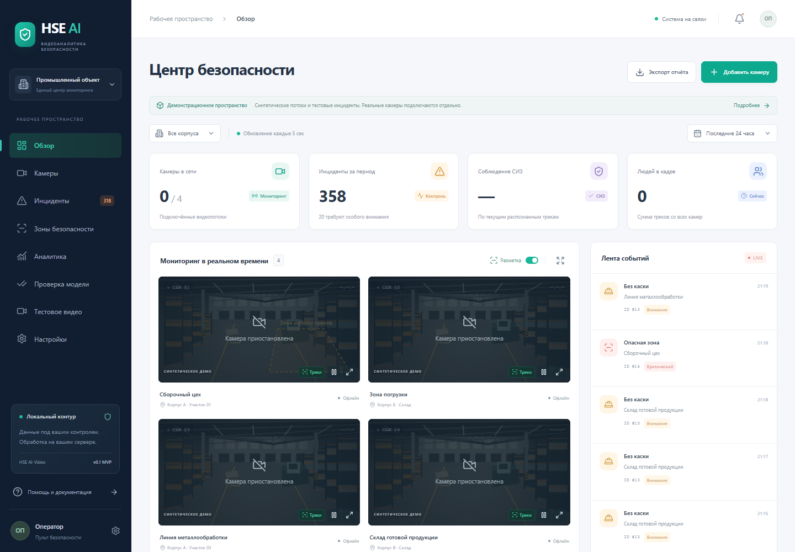
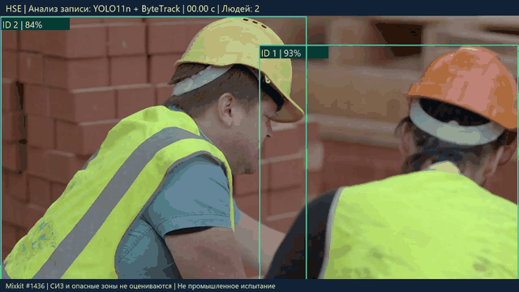
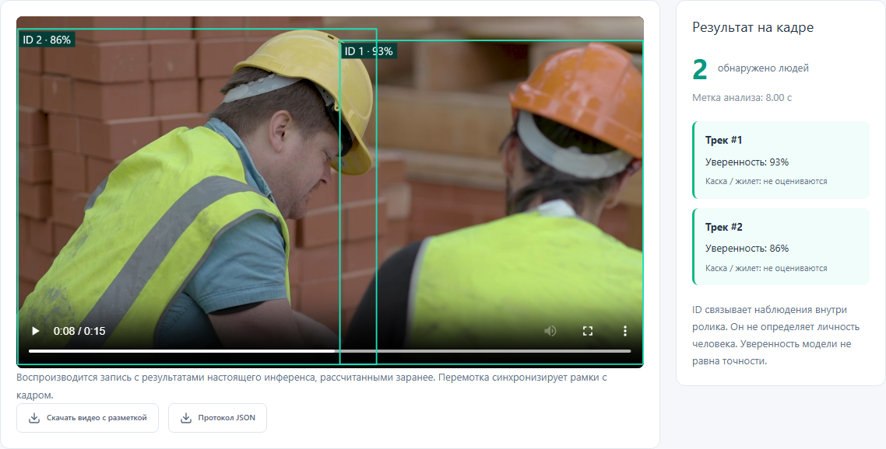
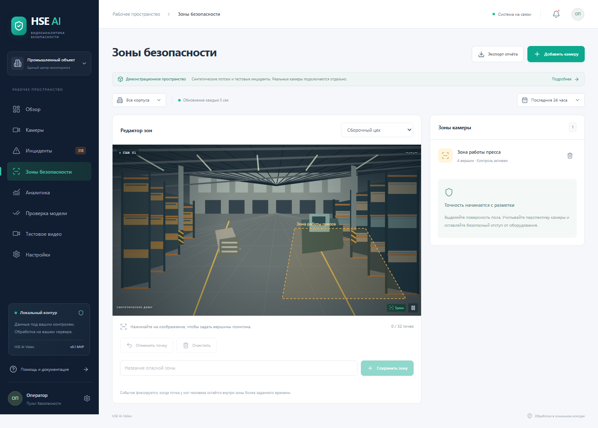
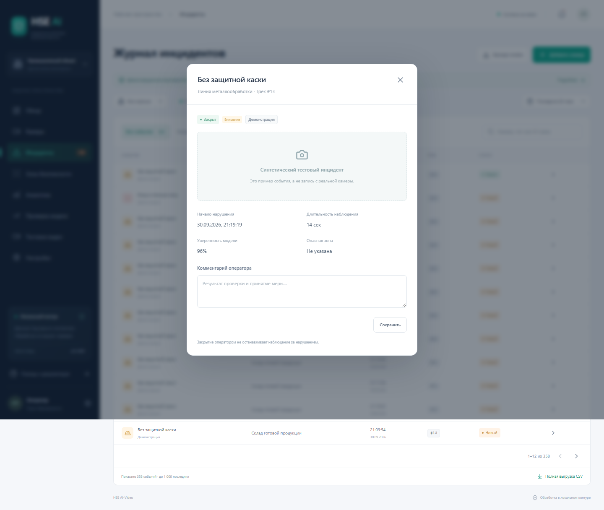
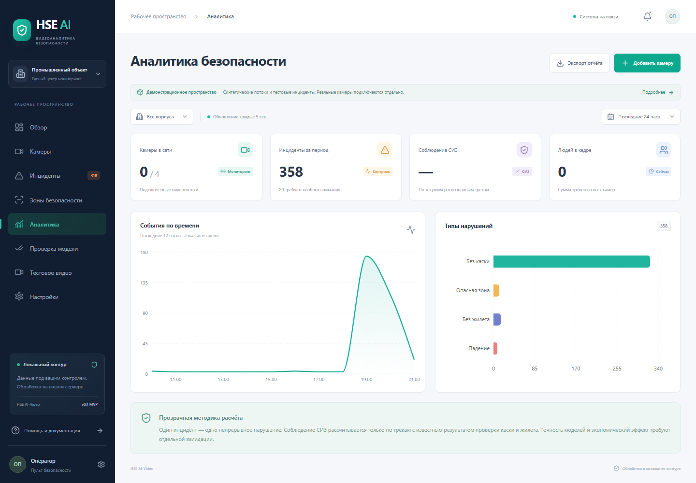

<div align="center">

# HSE AI-Video

**Видеоаналитика охраны труда: люди, опасные зоны и разбор инцидентов**

[](https://github.com/youngboy04/hse-ai-video/actions/workflows/ci.yml)


[Презентация PDF](submission/HSE_AI_Video.pdf) · [Видео проекта](docs/demo/hse-ai-video.mp4) · [Анализ рабочих](public/samples/workers-analyzed.mp4) · [Запуск](#быстрый-запуск) · [Материалы для жюри](submission/README.md)

</div>

HSE AI-Video объединяет видеопотоки, зоны контроля и журнал событий в одном интерфейсе оператора. Обработка кадров и хранение данных могут выполняться на сервере предприятия. Первый сценарий для пилота — вход человека в заданную опасную зону с формированием одного инцидента вместо повторных кадровых тревог.

**Текущая стадия — программный прототип.** Реальный YOLO11n подключён для обнаружения людей, ByteTrack связывает наблюдения внутри камеры. Модели касок, жилетов и поведения пока не установлены. Демонстрационные камеры и события явно обозначены как синтетические; отдельный ролик рабочих содержит результаты настоящего инференса.

## Видео проекта

### Обзор интерфейса

Пульт оператора, карточка инцидента, редактор зон, аналитика и реальное видео рабочих. Нажмите на изображение, чтобы открыть MP4.

[](docs/demo/hse-ai-video.mp4)

**[Смотреть / скачать демонстрацию приложения →](docs/demo/hse-ai-video.mp4)**

### Как система анализирует рабочих

Реальная съёмка со строительного участка: **15,79 с**, **127 обработанных кадров**, **два ID треков**. YOLO11n возвращает рамки людей, ByteTrack назначает ID, браузер совмещает разметку со временем видео.

[](public/samples/workers-analyzed.mp4)

**[Видео с разметкой MP4 →](public/samples/workers-analyzed.mp4)** · [Покадровый протокол JSON](public/samples/workers-analysis.json) · [Источник и лицензия](public/samples/README.md)

В приложении откройте **«Тестовое видео»**: доступны воспроизведение, перемотка, отключение рамок и скачивание результата. Это сохранённый анализ реальной модели; повторное воспроизведение не запускает инференс заново. СИЗ и опасные зоны в этом крупном плане не оцениваются. Люди на видео не являются заявленными участниками пилота.

## Скриншоты

<table>
  <tr>
    <td width="50%"><b>Реальное видео и треки</b><br><a href="docs/demo/workers-video.png"></a></td>
    <td width="50%"><b>Редактор зон</b><br><a href="docs/demo/zones.png"></a></td>
  </tr>
  <tr>
    <td><b>Журнал инцидентов</b><br><a href="docs/demo/incidents.png"></a></td>
    <td><b>Аналитика</b><br><a href="docs/demo/analytics.png"></a></td>
  </tr>
</table>

## Возможности

| Сценарий | Реализация |
|---|---|
| Наблюдение | Камеры, Canvas-потоки, рамки, пауза и развёрнутый просмотр |
| Опасные зоны | Редактор полигонов, проверка положения нижней точки трека, временная фильтрация |
| Разбор событий | Группировка в интервалы, статусы, комментарии, снимки и видеофрагменты |
| Отчётность | Фильтры по периоду и корпусу, графики, CSV-экспорт |
| Проверка модели | Загрузка JPEG/PNG/WebP, результат с координатами и хешем модели |
| Реальные источники | PyAV/RTSP, переподключение, очередь свежего кадра и адаптивный пропуск кадров |
| Локальное развёртывание | SQLite для демонстрации; Compose с PostgreSQL, Redis и S3-хранилищем |

## Быстрый запуск

Для просмотра интерфейса и подготовленного видео **GPU и скачивание весов не нужны**. Требуются Python 3.11+ и Node.js 22.12+; первоначальная установка пакетов требует интернета.

### Windows

```powershell
git clone https://github.com/youngboy04/hse-ai-video.git
cd hse-ai-video
.\start-local.ps1
```

Откройте **http://127.0.0.1:5173**. API: **http://127.0.0.1:8000/api/docs**. Скрипт устанавливает зависимости; `Ctrl+C` завершает запущенные сервисы.

### Linux / macOS

```bash
git clone https://github.com/youngboy04/hse-ai-video.git
cd hse-ai-video
python3 -m venv .venv
.venv/bin/pip install -r backend/requirements.txt
npm ci
.venv/bin/python scripts/dev.py
```

### Docker Compose

```bash
cp .env.example .env
docker compose up --build -d
```

Интерфейс: **http://127.0.0.1:8080**. Перед публикацией в сети задайте собственные ключи и пароли в `.env`. На рабочей машине проверена конфигурация Compose; сквозной запуск Docker/K3s пока не подтверждён.

### Распознавание собственных кадров

Веса не включены в Git. После первого локального запуска установите и экспортируйте детектор:

```powershell
.\.venv\Scripts\python.exe -m pip install -r requirements-export.txt -r inference/requirements.txt -r ingestion/requirements.txt
.\.venv\Scripts\python.exe scripts/export_models.py --detector yolo11n.pt
.\start-local.ps1 -WithAI
```

В разделе **«Проверка модели»** загрузите изображение. Для RTSP добавьте камеру и настройте зону. [Контракты моделей, переменные окружения и развёртывание](docs/TECHNICAL_GUIDE.md) · [Происхождение YOLO11n](models/MODEL_CARD.md).

## Архитектура

```text
IP-камера → PyAV / свежий кадр → ONNX Runtime + ByteTrack
                                      ↓
                          FastAPI / фильтрация событий
                                      ↓
                     SQL + Redis outbox + медиа / S3
                                      ↓
                           WebSocket → React / Canvas
```

Frontend, backend, inference и ingestion разделены. В реализации используются HTTP между сервисами и WebSocket в браузере. Triton, gRPC и WebRTC относятся к возможному развитию, а не к текущей реализации. [Техническое руководство](docs/TECHNICAL_GUIDE.md).

## Проверка и ограничения

Локально прошли **39 Python-тестов**, **8 браузерных сценариев** и сборка frontend. Проверены геометрия зон, временная фильтрация, API/доступ, работа ONNX/ByteTrack на контрактных весах, медиа, воспроизведение и перемотка реального ролика. CI выполняет тесты и сборку после отправки изменений.

```bash
python -m pip install -r requirements-dev.txt
python -m pytest -q
npm ci
npm run build
npx playwright install chromium
npm run test:e2e
```

На COCO8 (8 изображений, 10 размеченных людей) получены **TP=4, FP=0, FN=6** при confidence=0.35 и IoU=0.5. Набор может пересекаться с обучением YOLO11: это функциональная проверка, **не независимая оценка промышленной точности**. [Протокол](docs/evidence/report.json) · [Условия и повторение](docs/evidence/README.md).

Промышленный пилот и подтверждённые предзаказы отсутствуют. Точность 99%, экономия 70%, распознавание СИЗ и падений не заявляются как достигнутые результаты. Платформа не заменяет ограждения, блокировки оборудования и процедуры охраны труда.

## Материалы для конкурса

| Материал | Файл |
|---|---|
| Презентация, 14 слайдов по официальному шаблону | **[PDF](submission/HSE_AI_Video.pdf)** · [PPTX](submission/HSE_AI_Video.pptx) |
| Финансовая гипотеза с формулами | [Excel](submission/HSE_AI_Video_Finance.xlsx) |
| Описание для анкеты и список оставшихся данных | [Текст заявки](docs/application.md) |
| Сценарий пилота и предлагаемые критерии приёмки | [План пилота](docs/pilot-plan.md) |
| Порядок просмотра и проверки для жюри | [Комплект сдачи](submission/README.md) |

Финансовые значения являются расчётными допущениями. Заявка на сайте конкурса из этого репозитория не отправляется автоматически.

## Автор и материалы

**Павлов Иван Владимирович** — инициатор проекта. Контакт: [ivanp246459@gmail.com](mailto:ivanp246459@gmail.com).

[История изменений](CHANGELOG.md) · [Сторонние компоненты, видео и лицензии](THIRD_PARTY_NOTICES.md)
