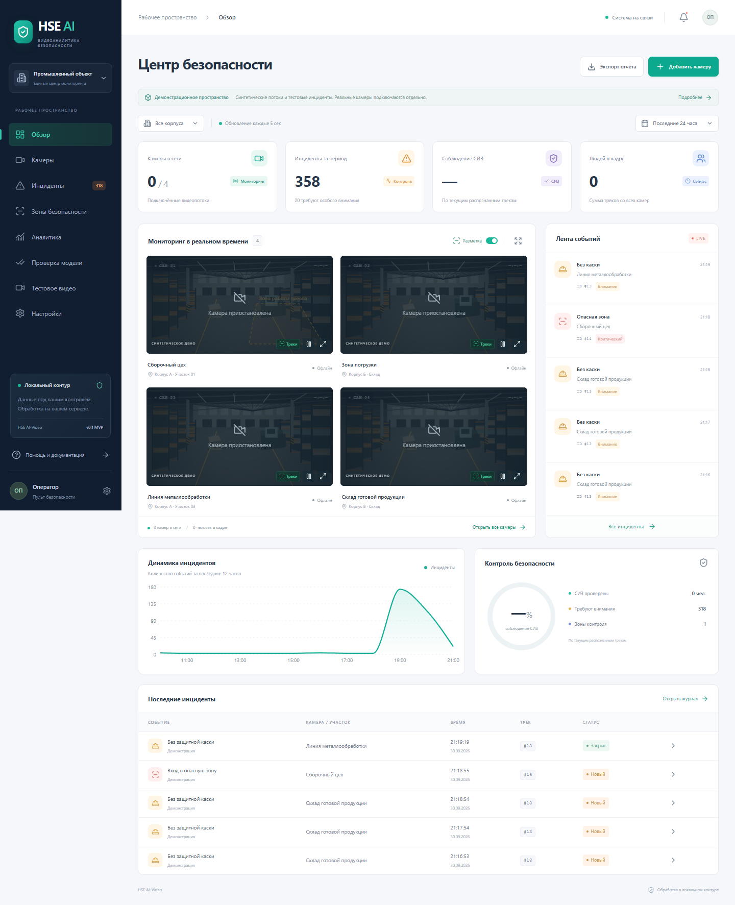

# Техническое руководство HSE AI-Video

Программный прототип видеоаналитики охраны труда: пульт оператора, контроль СИЗ, опасные зоны, история инцидентов и отдельный ONNX-инференс. Интерфейс и документация на русском языке. Внешние облачные API, CDN и удалённые изображения при работе приложения не используются.

**По умолчанию включено демо.** Четыре сцены нарисованы программно; треки и исходная история синтетические и явно помечены. События демонстрации проходят через тот же движок агрегации, что и реальные камеры. Обученные веса СИЗ и ST-GCN в репозиторий не включены. Без соответствующей модели результат проверки — `null`, а не «СИЗ отсутствует».



## Доказательства для конкурса

В разделе **«Тестовое видео»** доступна реальная съёмка двух рабочих: 15,79 секунды, 127 обработанных кадров, детекция YOLO11n и ID ByteTrack. Можно включать рамки, перематывать и [скачать MP4 с разметкой](../public/samples/workers-analyzed.mp4). Это сохранённый реальный инференс, а не анализ при каждом воспроизведении. [Источник, лицензия и команда повторения](../public/samples/README.md).

В локальной установке подключён настоящий предобученный YOLO11n; [карточка модели](../models/MODEL_CARD.md) описывает происхождение, лицензию и хеш. Веса исключены из Git. Раздел **«Проверка модели»** позволяет загрузить JPEG/PNG/WebP и скачать измеренный результат с координатами и версией модели. Каски, жилеты и падения этот детектор не распознаёт.

Сохранены [отчёт с изображениями](../docs/evidence/report.html), [машиночитаемый протокол](../docs/evidence/report.json) и [команда повторения](../docs/evidence/README.md). Результат COCO8: 8 изображений, 10 людей, TP=4, FP=0, FN=6. Это функциональная проверка с возможным пересечением с обучением; для промышленной точности нужна независимая выборка. [План пилота](../docs/pilot-plan.md) связывает следующие действия с критериями конкурса.

## Быстрый запуск

### Windows, без Docker

Нужны Python 3.11+ и Node.js 22.12+.

```powershell
.\start-local.ps1
```

Откройте **http://127.0.0.1:5173**. API: **http://127.0.0.1:8000/api/docs**. Скрипт устанавливает зависимости и запускает API с SQLite и интерфейс. `Ctrl+C` завершает запущенные им процессы. Для RTSP и ONNX:

```powershell
.\start-local.ps1 -WithAI
```

Если зависимости уже установлены:

```powershell
.\.venv\Scripts\python.exe scripts/dev.py --with-ai
```

Если 8000/8001 заняты: `python scripts/dev.py --with-ai --backend-port 8100 --inference-port 8101`. Интерфейс останется на 5173, прокси и адреса сервисов перенастроятся автоматически.

Локальные параметры можно задать в `.env.local`. Не копируйте Docker-адреса `postgres`, `redis`, `minio` в локальные настройки без запущенных соответствующих сервисов. SQLite сохраняет историю в `hse.db`, медиа — в `data/snapshots/`. Скрытые учётные данные RTSP сохраняются в локальной БД; API оператора их не возвращает.

### Linux/macOS, без Docker

```bash
python3 -m venv .venv
.venv/bin/pip install -r backend/requirements.txt
npm ci
.venv/bin/python scripts/dev.py
```

### Docker Compose

```bash
cp .env.example .env
docker compose up --build -d
```

Интерфейс: **http://127.0.0.1:8080**. Поднимаются frontend/nginx, backend, inference, ingestion, PostgreSQL, Redis и MinIO. Данные сохраняются в именованных volumes. Остановка без удаления данных: `docker compose down`.

Внешний порт по умолчанию привязан к loopback. Для установки в сети задайте собственные `POSTGRES_PASSWORD`, `SERVICE_TOKEN`, `OPERATOR_TOKEN`, `S3_ACCESS_KEY`, `S3_SECRET_KEY`, настройте публикацию порта и TLS на корпоративном reverse proxy. Оператор вводит `OPERATOR_TOKEN` в разделе «Настройки». Веб-сокет получает ключ первым сообщением, без размещения в URL.

Сборка образов и установка пакетов требуют сети. Для закрытого контура заранее перенесите образы и проверенные модели во внутренний реестр. Текущий MinIO-образ закреплён для воспроизводимого пилота; для промышленной эксплуатации используйте одобренную организацией сборку или собственный совместимый S3-сервис.

## Что работает

| Модуль | Реализованное поведение |
|---|---|
| Обзор | Сводка, четыре Canvas-потока, лента событий, график, текущая проверка СИЗ |
| Камеры | Добавление RTSP/demo, включение/остановка, поиск, развёрнутый просмотр, пауза и разметка |
| Проверка модели | Загрузка изображения, рамки детектора, хеши и JSON; протокол набора с TP/FP/FN и задержкой |
| Инциденты | Поиск, фильтры статуса и периода, пагинация, комментарии, взятие в работу и закрытие |
| Отчёты | CSV за выбранный период и корпус; защита текстовых полей от spreadsheet-formula injection |
| Зоны | Полигон 3–32 вершины, отмена точек, валидация самопересечения и нулевой площади, удаление с подтверждением |
| Инжестирование | PyAV, поток декодера на камеру, очередь одного свежего кадра, адаптивный интервал, reconnect с backoff |
| Инференс | ONNX Runtime, YOLO raw-output decoder, NMS, настоящий ByteTrack из Supervision, каскадный PPE, YOLO Pose/normalized pose, временная модель поведения |
| События | Debounce по секундам, ключ `camera + track + kind + zone`, завершение при потере трека, история в SQL |
| Redis | Transactional outbox в SQL и доставка в Redis Stream `hse:events` с повтором при недоступности |
| Медиа | JPEG при открытии реального инцидента, MP4 примерно 5 секунд до + 5 после регистрации, локальное хранение и повторяемое зеркалирование в MinIO |
| Доступ | Ключ оператора для API/WS, отдельный сервисный ключ для inference/ingestion, маскирование RTSP-адреса |
| Развёртывание | Dockerfiles, Compose, генератор и манифест пилотного K3s, health endpoints |

Счётчик людей — сумма треков по камерам, не число уникальных сотрудников. Идентификаторы действуют в пределах камеры и процесса трекинга; распознавание личности не выполняется. Процент СИЗ учитывает только треки с известными результатами обеих проверок. Уверенность в карточке — оценка детектора, а не измеренная точность системы.

## Архитектура и протоколы

```text
IP-камеры RTSP
   │
   ▼
ingestion / PyAV
  decoder threads → latest-frame queue → adaptive sampling
   │ JPEG / internal HTTP
   ▼
inference / FastAPI + ONNX Runtime
  YOLO person → ByteTrack → PPE crops → pose → temporal classifier
   │ JSON tracks + исходный JPEG
   ▼
backend / FastAPI
  foot-point geofence → temporal debounce → SQL transaction + outbox
   ├── PostgreSQL (SQLite в локальном режиме)
   ├── Redis Streams (at-least-once)
   ├── локальные JPEG/MP4 → S3 media outbox → MinIO
   └── WebSocket: JSON metadata, затем binary JPEG
          ▼
       React + TypeScript + Canvas + Zustand + Recharts
```

В этой реализации выбран предусмотренный в задании вариант FastAPI + ONNX Runtime. Межсервисная передача — JPEG multipart HTTP, браузерная — WebSocket. Triton, gRPC/ZeroMQ, shared memory и WebRTC не выдаются за реализованные. Такой вариант позволяет проверить всю цепочку MVP на CPU и заменить транспорт отдельно.

`/api/ws/{camera_id}` принимает `{ "token": "..." }`, затем отдаёт:

```json
{"type":"frame","camera_id":"cam-01","timestamp":"2026-09-30T12:00:00+00:00","demo":false,"fps":8,"latency_ms":42,"tracks":[{"id":12,"bbox":[0.2,0.3,0.4,0.8],"confidence":0.94,"helmet":true,"vest":null,"fall":null}]}
```

Координаты нормализованы в `[0,1]`. После метаданных реального кадра идёт бинарное WebSocket-сообщение JPEG. У клиента очередь ограничена одним кадром; медленные подписчики не накапливают задержку. Демопоток передаёт только метаданные, сцену рисует браузер. Оверлеи обновляются через `requestAnimationFrame`; 60 FPS на произвольном клиенте не гарантируется.

## Подключение реальных моделей

1. Положите проверенные ONNX-файлы в `models/`.
2. Запустите inference/ingestion (`-WithAI` или Compose).
3. Проверьте состояние в интерфейсе «Настройки» / `GET http://127.0.0.1:8001/health` при локальном запуске.
4. Добавьте RTSP-камеру и разметьте зону.
5. Для чистого рабочего контура используйте отдельную БД с `DEMO_MODE=false`. Выключение demo не удаляет уже записанные демонстрационные события.

| Файл | Вход FP32, RGB | Выход / требования |
|---|---|---|
| `person.onnx` | `[1,3,640,640]`, `/255`, letterbox 114 | YOLOv8/YOLO11 `[1,4+C,N]`, xywh в пикселях input, class probabilities; без embedded NMS. `PERSON_CLASS_ID=0` по умолчанию |
| `ppe.onnx` | crop всего человека, resize `[1,3,224,224]`, `/255` | `[1,2]` вероятности **наличия** `[helmet, vest]`. ≥0.8 — есть, ≤0.2 — нет, иначе неизвестно. Это специально обученный классификатор, COCO-веса его не заменяют |
| `pose.onnx` | crop человека, resize по shape входа, `/255` | Raw YOLOv8-pose `[1,56,N]` либо адаптер `[1,17,3]` с нормализованными x,y,confidence. Координаты переводятся в полный кадр |
| `behavior.onnx` | `[1,3,30,17,1]`: x,y,confidence × время × сустав × человек | `[1,2]` вероятности `[normal,fall]`; порог падения 0.9. Нужна обученная ST-GCN или совместимая временная сеть |

Для проверки загрузчика существуют тестовые ONNX-графы в тестах. Они не обучены, не устанавливаются в `models/` и не являются моделями видеоаналитики.

Опциональный экспорт публичных detector/pose весов (установка и загрузка выполняются только при явном запуске команды):

```bash
pip install ultralytics onnx
python scripts/export_models.py --detector yolo11x.pt --pose yolov8x-pose.pt
```

На слабом CPU для технической проверки можно выбрать `yolo11n.pt`; показатели качества зависят от обученной модели и данных. Не используйте raw end-to-end/NMS-вариант экспорта с несовместимым output. PPE и behavior веса нужно обучить или предоставить отдельно. Проверяйте лицензии выбранных моделей при поставке продукта.

`ONNX_PROVIDER` по умолчанию `CPUExecutionProvider`. Для OpenVINO замените пакет `onnxruntime` в образе на совместимый `onnxruntime-openvino`; для CUDA — на `onnxruntime-gpu` и настройте драйверы/runtime. Выбор отсутствующего provider завершает запуск ошибкой, не маскируется CPU fallback. Поддержка конкретного процессора проверяется по матрице runtime; совместимость с отечественными CPU не заявляется автоматически.

Временное окно behavior — **30 обработанных кадров**, при 8 FPS около 3.75 секунд; при адаптивном sampling длительность меняется. Это не гарантированная секунда исходного видео. Обучение временного классификатора должно соответствовать этому sampling; для промышленной детекции падений требуется нормализация временной шкалы и валидация на целевом FPS. Пропуск наблюдений разрывает накопление истории. Без pose/behavior весов анализ падений не производится.

## События и доказательства

- Нарушение подтверждается после `DEBOUNCE_SECONDS` (по умолчанию 2). Отрицательный кадр сбрасывает неподтверждённый триггер. Разрыв кадров дольше `CLOSE_AFTER_SECONDS` (3) не считается непрерывным наблюдением.
- Завершение интервала сохраняет момент последнего положительного кадра. Закрытие оператором — независимый статус: оно не прекращает наблюдение и не создаёт новый инцидент на каждом кадре.
- После перезапуска backend незавершённые интервалы закрываются с явной пометкой. Память треков не восстанавливается.
- SQL outbox фиксируется вместе с инцидентом. Redis может получить повтор события при сбое после публикации; потребитель обязан дедуплицировать по `event_id`. Без Redis outbox остаётся в SQL.
- Клип создаётся из сэмплированных кадров с их временными метками, без аудио. У разорванного/нового потока буфер может быть короче десяти секунд. Это не архив исходного полного FPS. В карточке реального события доступна кнопка «Клип»; до завершения записи API вернёт 404.
- Сначала медиа записывается в локальный persistent volume, затем повторяемая очередь отправляет его в закрытый S3 bucket. Первичный путь чтения клипов — локальный volume. Автоматическое удаление, политика хранения, восстановление локального индекса из S3 и выбор «лучшего» кадра за весь интервал пока не реализованы.

## K3s / Kubernetes

`deploy/k8s.yaml` — генерируемый манифест **одного пилотного узла** с PVC и ClusterIP-сервисами, не конфигурация отказоустойчивого кластера. API, ingestion и inference используют по одной реплике: состояние треков и WebSocket-комнат находится в памяти. Увеличение реплик требует маршрутизации камер по владельцам и вынесения state/broadcast в Redis.

```bash
python deploy/render_k8s.py --registry registry.local/hse --tag 0.1.0
kubectl create namespace hse-video
# Скопируйте deploy/k8s-secrets.example.yaml, задайте собственные значения.
kubectl apply -f deploy/k8s-secrets.yaml
kubectl apply -f deploy/k8s.yaml
kubectl -n hse-video port-forward service/frontend 8080:80
```

Сначала соберите и загрузите образы `frontend`, `backend`, `inference`, `ingestion` с выбранным registry/tag. PVC `models` нужно наполнить моделями до перезапуска inference (через отдельный административный pod); в inference том подключён read-only. По умолчанию ожидается storage class K3s. TLS, ingress, NetworkPolicy, резервное копирование, external secrets и HA задаются инфраструктурой предприятия.

## Проверка

```powershell
.\.venv\Scripts\python.exe -m pip install -r requirements-dev.txt
.\.venv\Scripts\python.exe -m pytest -q
npm run build
npx playwright install chromium
npm run test:e2e
docker compose config --quiet
```

Тесты проверяют границы и вогнутые полигоны, отказ на самопересечении, debounce и потери кадров, разделение ID по камерам, неизвестные СИЗ, доступ к API/WS, маскирование паролей, жизненный цикл инцидента, CSV, настоящий ONNX Runtime + ByteTrack на контрактных весах и декодируемость MP4. Восемь браузерных сценариев проверяют мобильную вёрстку, Canvas-потоки, карточку события, экспорт, зоны, настройки и добавление камеры. Браузерные тесты используют отдельную временную БД.

На текущей машине проверены Python 3.13, Node 22, SQLite, ONNX CPU и Chromium. Docker Engine отсутствовал в рабочем состоянии, поэтому выполнена валидация Compose, **не сборка/запуск контейнеров**. Реальные RTSP-камеры, PostgreSQL/Redis/MinIO и K3s в этом окружении не проходили сквозные испытания.

## Демонстрационные материалы

- [Скринкаст MP4](../docs/demo/hse-ai-video.mp4), исходная запись WebM создаётся локально.
- [Обзор](../docs/demo/dashboard.png), [редактор зон](../docs/demo/zones.png), [аналитика](../docs/demo/analytics.png).
- Перезапись при работающем локальном приложении: `node scripts/capture-demo.mjs`.
- Конвертация в MP4: `python scripts/convert_demo.py` (нужен пакет PyAV).
- [Текст заявки и содержание конкурсных слайдов](../docs/application.md).

## Граница MVP

Не включены обучение/сертификация моделей, подтверждение точности 98–99%, промышленные нагрузочные испытания, измерения экономии 70%, Triton dynamic batching, Celery, TimescaleDB hypertables, распределённый track state, сквозная идентификация между камерами, SSO/RBAC и аудит действий операторов. Заявления о кратном ускорении или снижении травматизма требуют замеров и пилота. Платформа не заменяет аппаратные блокировки оборудования.

## Первичная техническая документация

Реализация сверялась с [FastAPI WebSockets](https://fastapi.tiangolo.com/advanced/websockets/), [lifespan](https://fastapi.tiangolo.com/advanced/events/), [ONNX Runtime Python API](https://onnxruntime.ai/docs/api/python/api_summary.html), [OpenVINO Execution Provider](https://onnxruntime.ai/docs/execution-providers/OpenVINO-ExecutionProvider.html), [Supervision trackers](https://supervision.roboflow.com/develop/trackers/) и [экспортом Ultralytics](https://docs.ultralytics.com/modes/export). Версия Supervision ограничена `<0.28`, чтобы сохранять используемый API ByteTrack.
